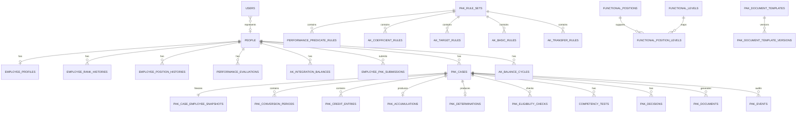

# Database Design — PAK Extension
## Sistem SDM BBPMP Provinsi Jawa Timur

**Versi:** 1.0  
**Tanggal:** 17 Oktober 2026  
**Status:** Proposed / acuan Phase 01-05; implementasi Phase 01 mengikuti [plan approved](plans/phase-01-foundation.md) dan [catatan foundation](foundation.md). Tabel fase berikutnya di dokumen ini belum diimplementasikan.

---

## 1. Kedudukan Dokumen

Dokumen ini **memperluas** `database.md` existing.

Dokumen ini tidak menggantikan prinsip existing:

- `people` = master identity;
- `personnel_snapshots` = kondisi pegawai per reporting period;
- `position_requirement_snapshots` = Peta Jabatan per import batch/version independen dari periode DUK;
- Laravel migration = schema source of truth;
- histori import existing tetap dipertahankan.

PAK harus tetap compatible dengan model master + snapshot existing.

---

# 2. Prinsip Desain PAK

1. `people.id` menjadi canonical foreign key pegawai.
2. PAK tidak bergantung pada lifetime `personnel_snapshots.id`.
3. Data yang digunakan untuk PAK final harus disnapshot.
4. Rule harus versioned.
5. Histori perhitungan tidak dihapus.
6. Ledger/detail angka harus dapat ditelusuri.
7. Draft dan final dibedakan.
8. Dokumen final menyimpan template/version.
9. SK dan TMT disimpan terpisah.
10. Calculation logic berada di application/domain layer, bukan database trigger.

---

# 3. Existing Entity yang Digunakan Kembali

```text
users
people
personnel_snapshots
reporting_periods
position_datasets
import_batches
position_requirement_snapshots
position_projection_values
roles
permissions
```

---

# 4. Perubahan Existing Table

## 4.1 `users`

Tambahkan:

| Column | Type | Rule |
|---|---|---|
| `person_id` | BIGINT UNSIGNED NULL | FK → `people.id`, unique bila terisi |

Tujuan:

- akun pegawai terhubung dengan identity master;
- portal pegawai hanya membaca data person miliknya.

Constraint:

```text
UNIQUE (person_id)
```

Jika satu person hanya boleh satu login.

---

# 5. ERD Konseptual



---

# 6. Identity dan Profile

## 6.1 `employee_profiles`

Satu row per person untuk atribut relatif stabil yang diperlukan PAK.

Suggested columns:

| Column | Type | Notes |
|---|---|---|
| `id` | BIGINT | PK |
| `person_id` | BIGINT | FK, unique |
| `karpeg_number` | VARCHAR(100) NULL | |
| `birth_place` | VARCHAR(150) NULL | |
| `birth_date` | DATE NULL | |
| `gender` | CHAR(1) NULL | bila canonical profile diperlukan |
| `institution_name` | VARCHAR(255) NULL | Current/default metadata; bukan sumber historis canonical |
| `work_unit_name` | VARCHAR(255) NULL | Current/default metadata; bukan sumber historis canonical |
| `extra_data` | JSON NULL | non-critical attributes |
| timestamps | | |

Critical PAK data jangan hanya disimpan dalam `extra_data`.

---

# 7. Histori Pangkat

## 7.1 `employee_rank_histories`

| Column | Type | Notes |
|---|---|---|
| `id` | BIGINT | PK |
| `person_id` | BIGINT | FK |
| `rank_name` | VARCHAR(150) | contoh Penata Tk.I |
| `grade_code` | VARCHAR(30) | contoh III/d |
| `tmt_start` | DATE | |
| `tmt_end` | DATE NULL | |
| `sk_number` | VARCHAR(150) NULL | |
| `sk_date` | DATE NULL | |
| `source` | VARCHAR(50) NULL | import/manual/PAK |
| `source_ref` | VARCHAR(255) NULL | |
| timestamps | | |

Recommended:

```text
INDEX (person_id, tmt_start)
```

Application validation mencegah overlapping active range kecuali ada alasan/versioning.

---

# 8. Histori Jabatan

## 8.1 `employee_position_histories`

| Column | Type | Notes |
|---|---|---|
| `id` | BIGINT | PK |
| `person_id` | BIGINT | FK |
| `position_name` | VARCHAR(255) | snapshot display |
| `position_type` | VARCHAR(100) NULL | JF/JA/Pelaksana/etc |
| `functional_position_id` | BIGINT NULL | canonical JF |
| `functional_level_id` | BIGINT NULL | jenjang |
| `tmt_start` | DATE | |
| `tmt_end` | DATE NULL | |
| `sk_number` | VARCHAR(150) NULL | |
| `sk_date` | DATE NULL | |
| `source` | VARCHAR(50) NULL | |
| timestamps | | |

---

# 9. Master Jabatan Fungsional

## 9.1 `functional_positions`

| Column | Type |
|---|---|
| `id` | BIGINT |
| `code` | VARCHAR(100) NULL |
| `name` | VARCHAR(255) |
| `is_active` | BOOLEAN |
| timestamps | |

## 9.2 `functional_levels`

| Column | Type | Example |
|---|---|---|
| `id` | BIGINT | |
| `category` | VARCHAR(30) | KEAHLIAN/KETERAMPILAN |
| `code` | VARCHAR(50) | AHLI_MUDA |
| `name` | VARCHAR(100) | Ahli Muda |
| `sort_order` | SMALLINT | |
| timestamps | | |

## 9.3 `functional_position_levels`

Mapping posisi ↔ jenjang yang diizinkan.

| Column | Type |
|---|---|
| `id` | BIGINT |
| `functional_position_id` | BIGINT |
| `functional_level_id` | BIGINT |
| `is_active` | BOOLEAN |

Unique:

```text
(functional_position_id, functional_level_id)
```

---

# 10. Performance Evaluation / SKP

## 10.1 `performance_evaluations`

| Column | Type | Notes |
|---|---|---|
| `id` | BIGINT | PK |
| `person_id` | BIGINT | FK |
| `evaluation_type` | VARCHAR(30) | Q1/Q2/Q3/Q4/ANNUAL/PROVISIONAL |
| `period_start` | DATE | |
| `period_end` | DATE | |
| `predicate_code` | VARCHAR(50) | |
| `source_status` | VARCHAR(30) | OFFICIAL/PROVISIONAL/SUPERSEDED |
| `source_document_path` | VARCHAR(500) NULL | private |
| `source_document_name` | VARCHAR(255) NULL | |
| `reason` | TEXT NULL | wajib provisional |
| `superseded_by_id` | BIGINT NULL | self FK |
| `entered_by` | BIGINT | FK users |
| `finalized_at` | TIMESTAMP NULL | |
| timestamps | | |

Index:

```text
(person_id, period_start, period_end)
(person_id, source_status)
```

Jangan menyimpan `percentage` sebagai satu-satunya kebenaran; percentage ditentukan rule saat calculation dan disnapshot pada conversion.

---

# 11. AK Integrasi

## 11.1 `ak_integration_balances`

| Column | Type |
|---|---|
| `id` | BIGINT |
| `person_id` | BIGINT |
| `effective_date` | DATE |
| `amount` | DECIMAL(15,6) |
| `source_document_path` | VARCHAR(500) NULL |
| `notes` | TEXT NULL |
| `entered_by` | BIGINT |
| timestamps | |

Index:

```text
(person_id, effective_date)
```

---

# 12. Pengajuan Pegawai

## 12.1 `employee_pak_submissions`

| Column | Type |
|---|---|
| `id` | BIGINT |
| `person_id` | BIGINT |
| `message` | TEXT |
| `status` | VARCHAR(30) |
| `reviewed_by` | BIGINT NULL |
| `reviewed_at` | TIMESTAMP NULL |
| `pak_case_id` | BIGINT NULL |
| timestamps | |

Suggested status:

```text
SUBMITTED
IN_REVIEW
LINKED_TO_PAK_CASE
NEEDS_INFORMATION
CLOSED
CANCELLED
```

Nama/NIP tidak perlu menjadi source identity baru; ambil dari `people`/snapshot.

---

# 13. PAK Rule Set

## 13.1 `pak_rule_sets`

| Column | Type |
|---|---|
| `id` | BIGINT |
| `code` | VARCHAR(100) |
| `name` | VARCHAR(255) |
| `version` | VARCHAR(50) |
| `first_used_at` | TIMESTAMP NULL; marker permanen penggunaan pertama pada case |
| `valid_from` | DATE NULL (DRAFT) |
| `valid_until` | DATE NULL |
| `reference` | TEXT NULL |
| `status` | VARCHAR(20) |
| timestamps | |

---


Phase 01: kedua tanggal boleh null; bila keduanya terisi valid_until >= valid_from. Tidak ada resolver, aktivasi, atau larangan overlap versi.

# 14. Predikat Rule

## 14.1 `performance_predicate_rules`

| Column | Type |
|---|---|
| `id` | BIGINT |
| `pak_rule_set_id` | BIGINT |
| `predicate_code` | VARCHAR(50) |
| `predicate_name` | VARCHAR(100) |
| `percentage` | DECIMAL(8,4) |
| timestamps | |

Persentase direkomendasikan sebagai factor:

```text
1.5000
1.0000
0.7500
0.5000
0.2500
```

---

# 15. Koefisien Rule

## 15.1 `ak_coefficient_rules`

| Column | Type |
|---|---|
| `id` | BIGINT |
| `pak_rule_set_id` | BIGINT |
| `functional_level_id` | BIGINT |
| `annual_coefficient` | DECIMAL(15,6) |
| timestamps | |

---

# 16. Target KP/KJ

## 16.1 `ak_target_rules`

| Column | Type |
|---|---|
| `id` | BIGINT |
| `pak_rule_set_id` | BIGINT |
| `functional_level_id` | BIGINT |
| `grade_from` | VARCHAR(30) NULL |
| `grade_to` | VARCHAR(30) NULL |
| `kp_target` | DECIMAL(15,6) NULL |
| `kj_target` | DECIMAL(15,6) NULL |
| timestamps | |

Target dapat lebih granular dari tabel ringkas jika regulasi membutuhkannya.

---

# 17. AK Dasar

## 17.1 `ak_basic_rules`

| Column | Type |
|---|---|
| `id` | BIGINT |
| `pak_rule_set_id` | BIGINT |
| `functional_level_id` | BIGINT |
| `grade_code` | VARCHAR(30) |
| `basic_ak` | DECIMAL(15,6) |
| timestamps | |

---

# 18. Rule Perpindahan

## 18.1 `ak_transfer_rules`

Flexible rule table.

| Column | Type |
|---|---|
| `id` | BIGINT |
| `pak_rule_set_id` | BIGINT |
| `origin_position_type` | VARCHAR(50) |
| `origin_grade_code` | VARCHAR(30) NULL |
| `target_level_id` | BIGINT NULL |
| `match_type` | VARCHAR(50) |
| `calculation_method` | VARCHAR(50) |
| `fixed_ak` | DECIMAL(15,6) NULL |
| `max_years` | SMALLINT NULL |
| `metadata` | JSON NULL |
| timestamps | |

`calculation_method` contoh:

```text
CONVERSION_PLUS_BASIC
CONVERSION_MAX_YEARS_PLUS_BASIC
FIXED_TABLE_VALUE
CARRY_PREVIOUS_JF_AK
```

---

# 19. PAK Case

## 19.1 `pak_cases`

| Column | Type |
|---|---|
| `id` | BIGINT |
| `case_number` | VARCHAR(100) NULL |
| `person_id` | BIGINT |
| `source_type` | VARCHAR(30) |
| `purpose_type` | VARCHAR(50) |
| `appointment_type` | VARCHAR(50) NULL |
| `period_start` | DATE |
| `period_end` | DATE |
| `status` | VARCHAR(50) |
| `pak_rule_set_id` | BIGINT NULL (draft Phase 01) |
| `source_submission_id` | BIGINT NULL |
| `created_by` | BIGINT |
| `finalized_by` | BIGINT NULL |
| `finalized_at` | TIMESTAMP NULL |
| `notes` | TEXT NULL |
| timestamps | |

Suggested `source_type`:

```text
EMPLOYEE_SUBMISSION
SYSTEM_WARNING
ADMIN_MANUAL
```

Phase 01 purpose_type (tujuan pemeriksaan, bukan mekanisme atau hasil eligibility):
ROUTINE, KP, KJ, KP_KJ.
Rule FK nullable untuk draft incomplete. Status/type memakai VARCHAR + validasi aplikasi, bukan database ENUM/CHECK daftar nilai.

---

# 20. Snapshot Pegawai per PAK

## 20.1 `pak_case_employee_snapshots`

Satu row per case.

| Column | Type |
|---|---|
| `id` | BIGINT |
| `pak_case_id` | BIGINT UNIQUE |
| `name` | VARCHAR(255) |
| `nip` | VARCHAR(32) NULL |
| `karpeg_number` | VARCHAR(100) NULL |
| `birth_place` | VARCHAR(150) NULL |
| `birth_date` | DATE NULL |
| `gender` | CHAR(1) NULL |
| `rank_name` | VARCHAR(150) NULL |
| `grade_code` | VARCHAR(30) NULL |
| `rank_tmt` | DATE NULL |
| `position_name` | VARCHAR(255) NULL |
| `functional_position_id` | BIGINT NULL |
| `functional_level_id` | BIGINT NULL |
| `position_tmt` | DATE NULL |
| `work_unit` | VARCHAR(255) NULL |
| `institution_name` | VARCHAR(255) NULL |
| `snapshot_payload` | JSON NULL |
| timestamps | |

Tujuan:

PAK 2026 tidak berubah saat DUK 2027 diimport.

---

# 21. Detail Konversi

## 21.1 `pak_conversion_periods`

| Column | Type |
|---|---|
| `id` | BIGINT |
| `pak_case_id` | BIGINT |
| `performance_evaluation_id` | BIGINT NULL |
| `period_start` | DATE |
| `period_end` | DATE |
| `month_count` | DECIMAL(8,4) |
| `predicate_code` | VARCHAR(50) |
| `predicate_factor` | DECIMAL(8,4) |
| `annual_coefficient` | DECIMAL(15,6) |
| `raw_ak` | DECIMAL(15,8) |
| `rounded_ak` | DECIMAL(15,6) |
| `source_type` | VARCHAR(30) |
| `rule_snapshot` | JSON |
| `calculation_trace` | JSON NULL |
| `status` | VARCHAR(20) |
| timestamps | |

Constraint/application guard:

- period tidak overlap pada case final;
- `period_start <= period_end`.

`month_count` tidak harus dihitung dari beda hari secara buta; resolver period harus mengikuti business rule bulan yang digunakan.

---

# 22. Komponen AK / Calculation Ledger

## 22.1 `pak_credit_entries`

| Column | Type |
|---|---|
| `id` | BIGINT |
| `pak_case_id` | BIGINT |
| `entry_type` | VARCHAR(50) |
| `source_type` | VARCHAR(50) NULL |
| `source_id` | BIGINT NULL |
| `description` | VARCHAR(255) NULL |
| `amount` | DECIMAL(15,6) |
| `effective_date` | DATE NULL |
| `status` | VARCHAR(20) |
| `metadata` | JSON NULL |
| timestamps | |

Suggested `entry_type`:

```text
INTEGRATION
BASIC
OLD_JF
ADJUSTMENT_EQUALIZATION
CONVERSION
EDUCATION
TRANSFER
CARRY_FORWARD
MANUAL_ADJUSTMENT
```

`MANUAL_ADJUSTMENT` wajib alasan + permission khusus.

---

# 23. Akumulasi

## 23.1 `pak_accumulations`

| Column | Type |
|---|---|
| `id` | BIGINT |
| `pak_case_id` | BIGINT UNIQUE |
| `opening_ak` | DECIMAL(15,6) |
| `new_ak` | DECIMAL(15,6) |
| `total_ak` | DECIMAL(15,6) |
| `snapshot` | JSON |
| `finalized_by` | BIGINT NULL |
| `finalized_at` | TIMESTAMP NULL |
| timestamps | |

`opening_ak`, `new_ak`, `total_ak` adalah summary; detail tetap di `pak_credit_entries`.

---

# 24. Penetapan PAK

## 24.1 `pak_determinations`

| Column | Type |
|---|---|
| `id` | BIGINT |
| `pak_case_id` | BIGINT UNIQUE |
| `cumulative_ak` | DECIMAL(15,6) |
| `kp_target` | DECIMAL(15,6) NULL |
| `kj_target` | DECIMAL(15,6) NULL |
| `kp_gap_or_excess` | DECIMAL(15,6) NULL |
| `kj_gap_or_excess` | DECIMAL(15,6) NULL |
| `kp_ak_met` | BOOLEAN |
| `kj_ak_met` | BOOLEAN |
| `recommendation` | VARCHAR(30) |
| `snapshot` | JSON |
| `determined_by` | BIGINT |
| `determined_at` | TIMESTAMP |
| timestamps | |

Suggested recommendation:

```text
NOT_ELIGIBLE
KP
KJ
KP_KJ
```

---

# 25. Eligibility Checks

## 25.1 `pak_eligibility_checks`

| Column | Type |
|---|---|
| `id` | BIGINT |
| `pak_case_id` | BIGINT |
| `scope` | VARCHAR(20) |
| `check_code` | VARCHAR(100) |
| `result` | VARCHAR(20) |
| `actual_value` | TEXT NULL |
| `required_value` | TEXT NULL |
| `source` | VARCHAR(100) NULL |
| `metadata` | JSON NULL |
| timestamps | |

`scope`:

```text
KP
KJ
GENERAL
```

`result`:

```text
PASS
FAIL
PENDING
NOT_APPLICABLE
```

---

# 26. Uji Kompetensi

## 26.1 `competency_tests`

| Column | Type |
|---|---|
| `id` | BIGINT |
| `pak_case_id` | BIGINT |
| `test_date` | DATE NULL |
| `result` | VARCHAR(20) |
| `recommendation_number` | VARCHAR(150) NULL |
| `document_path` | VARCHAR(500) NULL |
| `notes` | TEXT NULL |
| `entered_by` | BIGINT |
| timestamps | |

Result:

```text
PENDING
PASSED
FAILED
```

---

# 27. Keputusan / SK / TMT

## 27.1 `pak_decisions`

Satu case dapat memiliki lebih dari satu keputusan, misalnya KJ lalu KP.

| Column | Type |
|---|---|
| `id` | BIGINT |
| `pak_case_id` | BIGINT |
| `decision_type` | VARCHAR(20) |
| `status` | VARCHAR(30) |
| `sk_number` | VARCHAR(150) NULL |
| `sk_date` | DATE NULL |
| `tmt` | DATE NULL |
| `old_rank_name` | VARCHAR(150) NULL |
| `old_grade_code` | VARCHAR(30) NULL |
| `new_rank_name` | VARCHAR(150) NULL |
| `new_grade_code` | VARCHAR(30) NULL |
| `old_position_name` | VARCHAR(255) NULL |
| `old_level_id` | BIGINT NULL |
| `new_position_name` | VARCHAR(255) NULL |
| `new_level_id` | BIGINT NULL |
| `document_path` | VARCHAR(500) NULL |
| `metadata` | JSON NULL |
| timestamps | |

`decision_type`:

```text
KP
KJ
```

---

# 28. AK Balance Cycle

## 28.1 `ak_balance_cycles`

| Column | Type |
|---|---|
| `id` | BIGINT |
| `person_id` | BIGINT |
| `functional_level_id` | BIGINT NULL |
| `started_at` | DATE |
| `ended_at` | DATE NULL |
| `opening_balance` | DECIMAL(15,6) |
| `closing_balance` | DECIMAL(15,6) NULL |
| `closing_reason` | VARCHAR(50) NULL |
| `source_pak_case_id` | BIGINT NULL |
| `status` | VARCHAR(20) |
| timestamps | |

Tujuan:

- histori reset tidak hilang;
- siklus baru tidak menimpa siklus lama.

Rule efektif SK/TMT masih pending.

---

# 29. Dokumen PAK

## 29.1 `pak_document_templates`

| Column | Type |
|---|---|
| `id` | BIGINT |
| `code` | VARCHAR(50) |
| `name` | VARCHAR(255) |
| `is_active` | BOOLEAN |
| timestamps | |

Code:

```text
CONVERSION
ACCUMULATION
DETERMINATION
```

## 29.2 `pak_document_template_versions`

| Column | Type |
|---|---|
| `id` | BIGINT |
| `template_id` | BIGINT |
| `version` | VARCHAR(50) |
| `valid_from` | DATE |
| `valid_until` | DATE NULL |
| `template_path` | VARCHAR(500) NULL |
| `configuration` | JSON NULL |
| `created_by` | BIGINT |
| timestamps | |

## 29.3 `pak_documents`

| Column | Type |
|---|---|
| `id` | BIGINT |
| `pak_case_id` | BIGINT |
| `document_type` | VARCHAR(30) |
| `template_version_id` | BIGINT |
| `status` | VARCHAR(20) |
| `document_number` | VARCHAR(150) NULL |
| `generated_path` | VARCHAR(500) |
| `snapshot` | JSON |
| `generated_by` | BIGINT |
| `generated_at` | TIMESTAMP |
| `printed_at` | TIMESTAMP NULL |
| timestamps | |

Nomor boleh null V1.

---

# 30. Event/Audit PAK

## 30.1 `pak_events`

| Column | Type |
|---|---|
| `id` | BIGINT |
| `pak_case_id` | BIGINT |
| `event_code` | VARCHAR(100) |
| `actor_id` | BIGINT NULL |
| `payload` | JSON NULL |
| `occurred_at` | TIMESTAMP |
| `created_at` | TIMESTAMP |

Tidak perlu `updated_at` bila event immutable.

---

# 31. Index Rekomendasi

Minimal:

```text
performance_evaluations(person_id, period_start, period_end)
employee_rank_histories(person_id, tmt_start)
employee_position_histories(person_id, tmt_start)
pak_cases(person_id, status)
pak_cases(status, period_end)
pak_conversion_periods(pak_case_id, period_start, period_end)
pak_credit_entries(pak_case_id, entry_type)
pak_events(pak_case_id, occurred_at)
pak_decisions(pak_case_id, decision_type)
ak_balance_cycles(person_id, status)
```

Hindari over-indexing sebelum melihat query production.

---

# 32. Foreign Key / Delete Policy

Recommended:

```text
people -> PAK data             RESTRICT
pak_cases -> detail            CASCADE only while draft? Prefer controlled delete
finalized PAK                  never cascade-delete via normal UI
rule_sets -> rule rows         RESTRICT if used by finalized case
documents                      controlled
events                         immutable
```

Implementasi dapat menggunakan soft delete untuk entitas operasional tertentu.

Untuk record audit/final, prioritaskan retention daripada convenience delete.

---

# 33. Precision

Recommended:

```text
AK storage       DECIMAL(15,6)
raw calculation  DECIMAL(15,8) atau BigDecimal app-level
```

Display dokumen dapat 3 digit sesuai template.

Rounding harus dilakukan oleh satu service/policy.

---

# 34. Snapshot Policy

Finalized PAK harus menyimpan:

1. employee snapshot;
2. rule snapshot;
3. conversion detail;
4. accumulation snapshot;
5. determination snapshot;
6. template version;
7. relevant position requirement snapshot/reference jika KJ.

Tujuan:

hasil lama tetap reproducible.

---

# 35. Peta Jabatan Integration

Jangan FK langsung ke satu snapshot sebagai satu-satunya sumber keputusan final tanpa snapshot tambahan.

Saat eligibility KJ menggunakan Peta Jabatan:

- baca data `published`;
- catat published batch ID, position_version, published_at, dan nilai sumber yang digunakan;
- simpan relevant values ke `pak_eligibility_checks.metadata` atau determination snapshot.

Versi Peta Jabatan berikutnya dapat berubah. Pointer published pada position_datasets independen dari reporting_periods; bulan DUK bukan rekonstruksi historis Peta Jabatan.

---

# 36. Migration Order PAK

Recommended:

```text
01 add users.person_id
02 employee_profiles
03 functional_levels
04 functional_positions
05 functional_position_levels
06 employee_rank_histories
07 employee_position_histories
08 performance_evaluations
09 ak_integration_balances
10 pak_rule_sets
11 performance_predicate_rules
12 ak_coefficient_rules
13 ak_target_rules
14 ak_basic_rules
15 ak_transfer_rules
16 employee_pak_submissions
17 pak_cases
18 pak_case_employee_snapshots
19 pak_conversion_periods
20 pak_credit_entries
21 pak_accumulations
22 pak_determinations
23 pak_eligibility_checks
24 competency_tests
25 pak_decisions
26 ak_balance_cycles
27 pak_document_templates
28 pak_document_template_versions
29 pak_documents
30 pak_events
```

Dapat dibagi per phase, tidak harus satu deploy.

---

# 37. Suggested Eloquent Models

```text
EmployeeProfile
EmployeeRankHistory
EmployeePositionHistory
FunctionalPosition
FunctionalLevel
FunctionalPositionLevel
PerformanceEvaluation
AkIntegrationBalance
EmployeePakSubmission
PakRuleSet
PerformancePredicateRule
AkCoefficientRule
AkTargetRule
AkBasicRule
AkTransferRule
PakCase
PakCaseEmployeeSnapshot
PakConversionPeriod
PakCreditEntry
PakAccumulation
PakDetermination
PakEligibilityCheck
CompetencyTest
PakDecision
AkBalanceCycle
PakDocumentTemplate
PakDocumentTemplateVersion
PakDocument
PakEvent
```

Existing:

```text
Person
User
ReportingPeriod
PersonnelSnapshot
PositionRequirementSnapshot
```

---

# 38. Domain Service yang Diharapkan

Database design ini bukan alasan menaruh logic di Model/Filament.

Recommended:

```text
app/Domain/Pak/
├── Calculators/
│   └── ConversionCalculator.php
├── Services/
│   ├── PerformancePeriodResolver.php
│   ├── RuleResolver.php
│   ├── AccumulationService.php
│   ├── DeterminationService.php
│   ├── EligibilityService.php
│   ├── BalanceCycleService.php
│   └── DocumentService.php
├── DTOs/
├── Enums/
└── Exceptions/
```

---

# 39. Data yang Tidak Boleh Jadi Single Mutable Column di `people`

Jangan menambahkan sebagai satu-satunya kebenaran:

```text
people.total_ak
people.current_pak
people.current_kj_status
people.current_kp_status
```

Data tersebut merupakan hasil proses/histori.

Current state boleh di-cache bila diperlukan, tetapi canonical source tetap histori/PAK.

---

# 40. Pending Database Decisions

1. Apakah diperlukan dedicated table untuk correction/revision chain PAK.
2. Apakah `ak_balance_cycles` efektif berdasarkan TMT (recommended) atau event lain.
3. Mapping canonical JF dari Peta Jabatan existing.
4. Retention policy dokumen PAK.
5. Apakah pimpinan akan memiliki user/account di fase berikutnya.

Tidak boleh menghalangi Phase 01 kecuali berdampak pada schema yang irreversible.

## Implementasi Foundation

Schema Phase 01 mengikuti plans/phase-01-foundation.md: kategori JF dinormalisasi; histori verified wajib TMT nyata dan hanya jabatan utama; organisasi profil current/default bukan sumber historis; akun memakai is_active dan actor RESTRICT; audit mendukung subjek selain case. Tabel fase berikutnya belum diimplementasikan.
