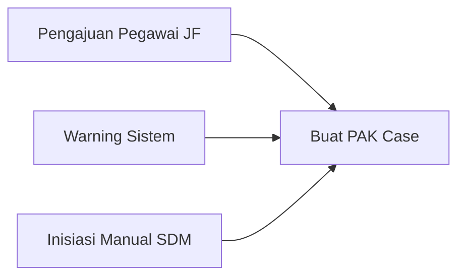
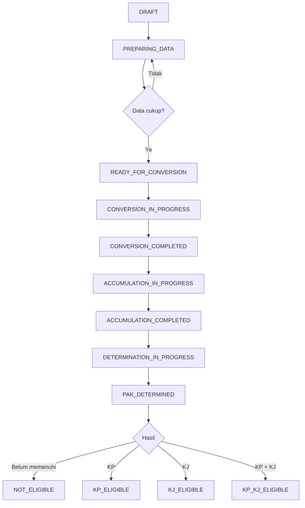
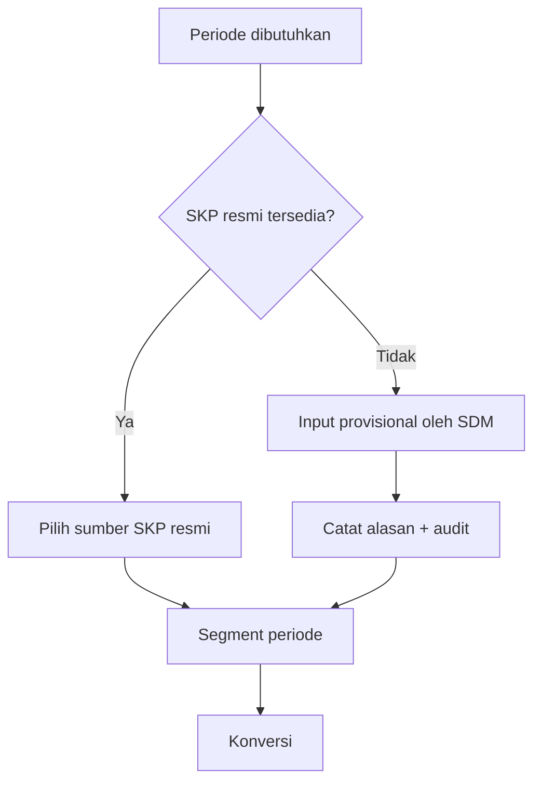
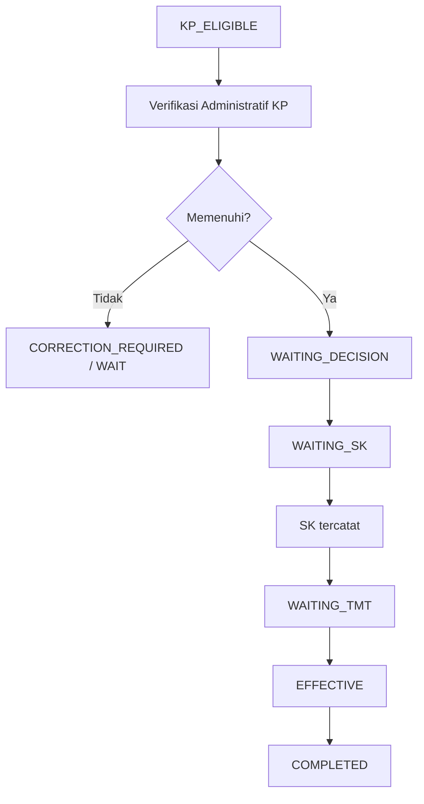
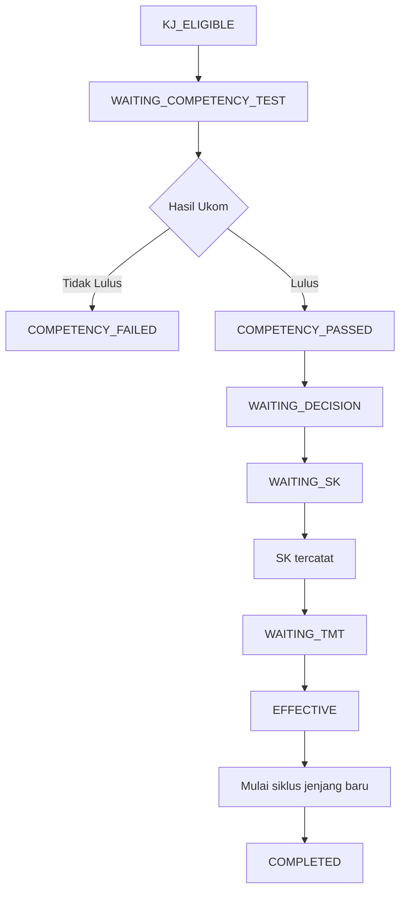
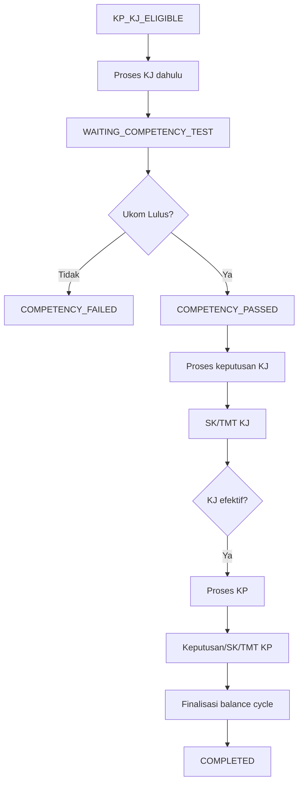
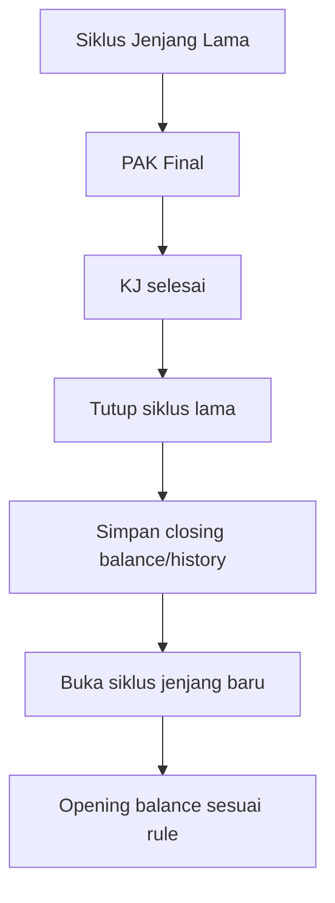
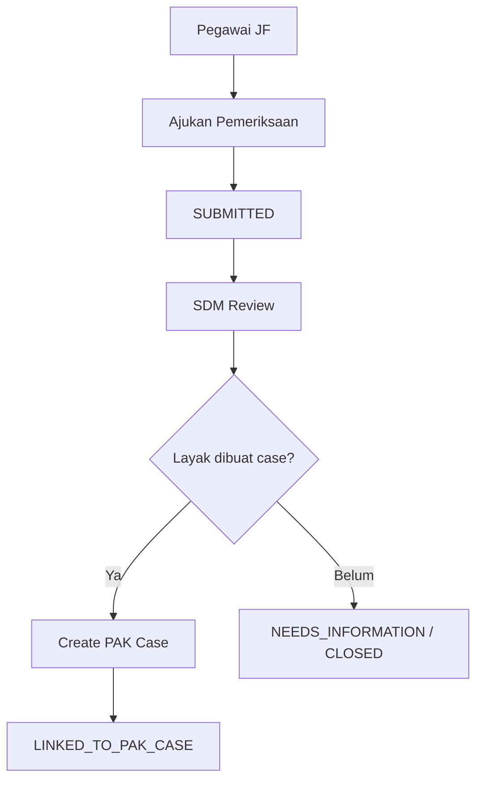

# Workflow PAK Konversi
## BBPMP Provinsi Jawa Timur

**Versi:** 1.0  
**Tanggal:** 17 Oktober 2026

---

## 1. Tujuan

Dokumen ini mendefinisikan state, transisi, aktor, dan alur utama proses PAK.

Business rule detail tetap mengacu pada `business-rules.md`.

---

# 2. Prinsip Workflow

1. PAK diproses oleh Tim SDM.
2. Pegawai hanya dapat mengajukan pemeriksaan dan melihat data miliknya.
3. Sistem dapat menghasilkan warning, tetapi tidak mengambil keputusan administratif final secara otomatis.
4. Konversi, Akumulasi, dan Penetapan adalah tiga tahap berbeda.
5. KJ memiliki sub-workflow Uji Kompetensi.
6. Jika KP dan KJ bersamaan, KJ didahulukan.
7. SK dan TMT dipisahkan.
8. Histori tidak dihapus ketika status berubah.
9. Finalized state tidak kembali ke draft tanpa mekanisme koreksi/revision.

---

# 3. Sumber Pembuatan PAK Case

PAK Case dapat dibuat dari:

```text
A. Employee Submission
B. System Warning
C. Manual SDM Initiation
```



---

# 4. Status Utama PAK Case

Recommended canonical status:

```text
DRAFT
PREPARING_DATA
READY_FOR_CONVERSION
CONVERSION_IN_PROGRESS
CONVERSION_COMPLETED
ACCUMULATION_IN_PROGRESS
ACCUMULATION_COMPLETED
DETERMINATION_IN_PROGRESS
PAK_DETERMINED
NOT_ELIGIBLE
KP_ELIGIBLE
KJ_ELIGIBLE
KP_KJ_ELIGIBLE
WAITING_COMPETENCY_TEST
COMPETENCY_PASSED
COMPETENCY_FAILED
WAITING_DECISION
WAITING_SK
WAITING_TMT
EFFECTIVE
COMPLETED
CANCELLED
CORRECTION_REQUIRED
```

Tidak semua case harus melewati semua status.

---

# 5. Workflow Utama



---

# 6. Tahap Persiapan Data

## 6.1 DRAFT

PAK Case baru dibuat.

Sumber:

- pengajuan pegawai;
- warning;
- manual.

Data minimum:

- person;
- sumber case;
- periode target;
- created_by.

## 6.2 PREPARING_DATA

SDM melengkapi/verifikasi:

- identitas pegawai;
- pangkat/golongan;
- jabatan;
- jenjang;
- TMT;
- SKP;
- AK Integrasi bila ada;
- jenis proses khusus bila relevan;
- Peta Jabatan/kebutuhan bila diperlukan.

## 6.3 READY_FOR_CONVERSION

Semua input minimum perhitungan tersedia.

Blocking validation:

- periode valid;
- sumber predikat tersedia atau provisional sah;
- tidak ada overlap yang tidak diizinkan;
- coefficient/rule dapat di-resolve.

---

# 7. Workflow SKP



Ketika SKP resmi kemudian tersedia:

```text
PROVISIONAL
    ↓
SUPERSEDED_BY_OFFICIAL
```

Jika PAK sudah final dan nilainya berbeda:

```text
CORRECTION_REQUIRED
```

Prosedur koreksi final mengikuti rule yang nanti dikonfirmasi.

---

# 8. Workflow Konversi

## 8.1 CONVERSION_IN_PROGRESS

System/SDM:

1. menentukan periode;
2. melakukan segmentasi;
3. resolve predikat;
4. resolve percentage;
5. resolve coefficient;
6. menghitung raw AK;
7. menerapkan rounding policy;
8. menyimpan calculation trace.

## 8.2 CONVERSION_COMPLETED

Semua detail conversion valid.

Satu case dapat memiliki N conversion lines.

Contoh:

```text
Nov-Dec 2023
Jan-Dec 2024
Jan-Dec 2025
Jan-Oct 2026
```

---

# 9. Workflow Akumulasi

## 9.1 ACCUMULATION_IN_PROGRESS

Komponen yang relevan dikumpulkan:

```text
AK Integrasi
AK Dasar
AK JF lama
AK Penyesuaian/Penyetaraan
AK Konversi
AK Pendidikan
AK Perpindahan
komponen sah lainnya
```

## 9.2 ACCUMULATION_COMPLETED

Sistem menyimpan:

- detail komponen;
- total;
- source trace;
- snapshot.

---

# 10. Workflow Penetapan PAK

## 10.1 DETERMINATION_IN_PROGRESS

Sistem melakukan:

- lookup target KP;
- lookup target KJ;
- hitung selisih;
- cek rule non-AK yang tersedia;
- menyimpan eligibility check.

## 10.2 PAK_DETERMINED

Output kalkulasi telah final untuk case/version tersebut.

Cabang:

```text
NOT_ELIGIBLE
KP_ELIGIBLE
KJ_ELIGIBLE
KP_KJ_ELIGIBLE
```

Catatan:

`ELIGIBLE` pada level ini berarti hasil PAK/rekomendasi, bukan perubahan pangkat/jenjang aktif.

---

# 11. Workflow KP Saja



Perubahan pangkat master/history dilakukan saat event efektif sesuai rule.

---

# 12. Workflow KJ Saja



Jika gagal:

```text
COMPETENCY_FAILED
```

Jenjang existing tetap aktif.

Apakah PAK dapat dipakai ulang pada Ukom berikutnya masih `PENDING`.

---

# 13. Workflow KP + KJ



Poin penting:

- KJ diproses lebih dahulu;
- AK tidak di-reset sebelum dependency KP selesai jika AK yang sama masih digunakan;
- status dan ledger harus menjelaskan urutannya.

---

# 14. Workflow SK dan TMT

Recommended model:

```text
Decision Approved
    ↓
WAITING_SK
    ↓
SK_ISSUED
    ↓
WAITING_TMT
    ↓
EFFECTIVE
```

Proposed semantics:

- `SK_ISSUED` = dasar keputusan telah ada;
- `EFFECTIVE` = perubahan telah berlaku sesuai TMT.

**Catatan:** penggunaan TMT sebagai trigger saldo/jenjang baru masih perlu konfirmasi final client.

---

# 15. Workflow Saldo / AK Cycle

Jangan melakukan:

```text
UPDATE employee.total_ak = 0
```

Recommended:



Jika KJ+KP:

penutupan siklus harus menunggu seluruh dependency yang menggunakan AK selesai.

---

# 16. Workflow Dokumen

Tiap PAK Case dapat menghasilkan:

```text
FORM_KONVERSI
FORM_AKUMULASI
FORM_PENETAPAN
```

Lifecycle dokumen:

```text
DRAFT
    ↓
GENERATED
    ↓
PRINTED
    ↓
SIGNED_EXTERNALLY (opsional dicatat)
    ↓
ARCHIVED
```

V1:

- nomor kosong;
- tidak ada TTE;
- signed externally/manual.

---

# 17. Workflow Pengajuan Pegawai



Suggested submission status:

```text
SUBMITTED
IN_REVIEW
LINKED_TO_PAK_CASE
NEEDS_INFORMATION
CLOSED
CANCELLED
```

---

# 18. Workflow Warning

Warning engine:

```text
Data SDM / SKP / AK / Position Need
        ↓
Rule Warning
        ↓
Candidate Alert
        ↓
SDM Review
        ↓
Create PAK Case (jika perlu)
```

Warning tidak mengubah:

- pangkat;
- jenjang;
- AK final;
- status kepegawaian.

---

# 19. Koreksi dan Revision

Finalized PAK tidak boleh dibuka kembali secara silent edit.

Jika ditemukan kesalahan:

```text
FINAL
  ↓
CORRECTION_REQUIRED
  ↓
Create Correction Version
  ↓
Recalculate
  ↓
Refinalize
```

Detail formal koreksi dokumen perlu disesuaikan keputusan client/regulasi.

---

# 20. Transition Guard

Contoh guard:

### DRAFT -> READY_FOR_CONVERSION
Harus memiliki:

- person;
- period;
- employee snapshot;
- source predicate/rule.

### CONVERSION_COMPLETED -> ACCUMULATION
Semua conversion line:

- valid;
- non-overlap;
- memiliki rule snapshot.

### ACCUMULATION_COMPLETED -> DETERMINATION
Total akumulasi telah final untuk version tersebut.

### KJ_ELIGIBLE -> WAITING_COMPETENCY_TEST
Kebutuhan/administrasi minimum KJ dinyatakan siap.

### WAITING_TMT -> EFFECTIVE
Tanggal efektif telah tercapai atau tindakan admin terotorisasi sesuai kebijakan implementasi.

---

# 21. Audit Event Minimum

Recommended event code:

```text
PAK_CASE_CREATED
PAK_CASE_UPDATED
SKP_ADDED
SKP_PROVISIONAL_ADDED
SKP_SUPERSEDED
CONVERSION_CALCULATED
CONVERSION_FINALIZED
ACCUMULATION_FINALIZED
PAK_DETERMINED
KP_ELIGIBLE
KJ_ELIGIBLE
COMPETENCY_RESULT_RECORDED
SK_RECORDED
TMT_REACHED
BALANCE_CYCLE_CLOSED
BALANCE_CYCLE_OPENED
DOCUMENT_GENERATED
DOCUMENT_PRINTED
CORRECTION_STARTED
CASE_COMPLETED
```

---

# 22. Pending Workflow Decisions

1. Jika provisional berbeda dari SKP resmi setelah finalisasi.
2. Reuse PAK setelah gagal Ukom.
3. Effective trigger saldo baru: SK atau TMT.
4. Prosedur formal koreksi dokumen yang sudah ditandatangani.

Implementation plan wajib menandai area ini dan tidak membuat asumsi tersembunyi.
